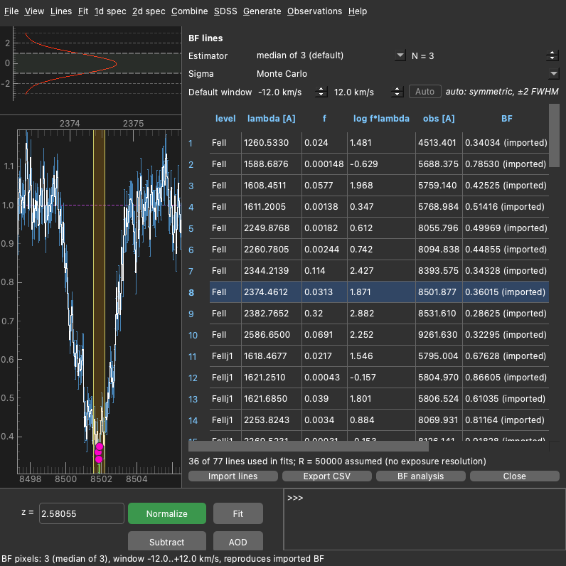
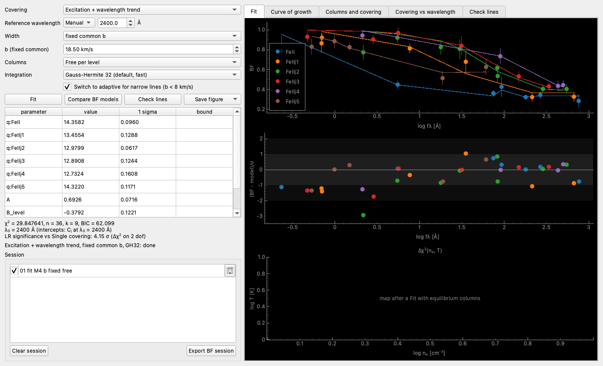
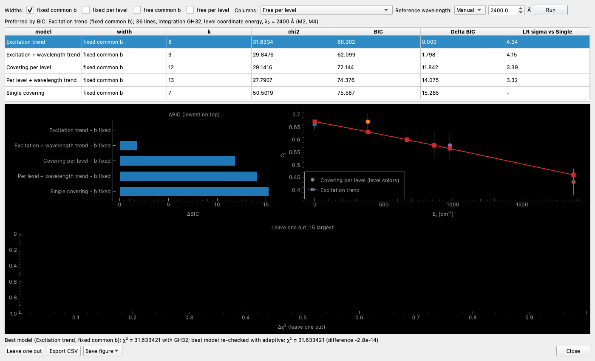

.. _bf-analysis:

Bottom flux analysis
====================

Bottom flux (BF) is the normalized flux near the minimum of an absorption line. If the absorber covers only a part of the background source, saturated lines do not reach zero and their bottoms show the covering factor directly.
The BF tools measure BF for a set of lines, fit it with a simple model of partial covering and compare several laws for the covering factor.
They are useful when the lines of one species arise from several levels (e.g. Fe II ground and excited fine-structure levels), and one wants to know whether all of them cover the source equally.

The model for each line is

.. math::

   BF = 1 - C + C\,[G \ast e^{-\tau(v)}](0), \qquad \tau(v) = \tau_0\, e^{-(v/b)^2}, \qquad \tau_0 = 1.497\times10^{-15}\; 10^{q} f \lambda ,

where C is the covering factor, G is the line spread function (Gaussian with FWHM = c/R), f and lambda (in Angstrom) are the oscillator strength and the rest wavelength, and q = log(N/b) with N in cm^-2 and b in km/s.
The BF is taken at the line centre, i.e. the intrinsic profile is convolved with the instrument and evaluated at v = 0.

The workflow is:

* load the spectrum, build the continuum and normalize (``N``);
* show the lines at the redshift of the absorption system (``Lines`` menu or ``show FeII`` in the :ref:`console`);
* mark the lines in the BF lines panel;
* fit and compare the models in the BF analysis window.

BF lines panel
--------------

The panel is opened by ``F10`` or ``Fit/BF lines``. It is inserted next to the main plot, like the Fit parameters panel (``F4``).

The lines are added in two ways:

* ``s`` + mouse region: select the pixels around the line, as for the usual fit. A shown line label whose centre lies in a selected run of pixels is added to the list, and this run is its window. The same selected pixels are used by ``Fit``, so one selection serves both.
* double-click on the line label: add or remove the line. Adding selects the default window around it.

Deselection with ``d`` + mouse region works as usual. Lines whose selected run disappears leave the list.

The BF is measured only on the normalized spectrum. If the continuum is not built, the panel says so in the status bar.

Settings above the table:

* **Estimator**: how the BF is taken from the pixels in the window. The default is the median of 3 pixels centred on the lowest pixel. Other options are the minimum pixel, and the median or the mean of N pixels (N odd, 3 to 15).
* **Sigma**: uncertainty of the BF. Monte Carlo (default) resamples the pixels within their errors and repeats the estimator. The other option is the median error of the pixels used (``median pixel error``).
* **Default window**: velocity range around the line where the minimum is searched. In the automatic mode it is set from the components of the fit model within 300 km/s of this redshift (from the first to the last component, +- half their mean separation; one component: +- its b), otherwise it is +-2 FWHM of the line spread function, at least 3 pixels on each side. Editing the values switches to manual mode, ``Auto`` returns to the automatic one.

The table shows for each line: level, rest wavelength, f, log(f lambda), observed wavelength, BF, sigma, flag and use.

* **flag**: clear / unclear / blend. Flags change only the markers in the plots. Blends read by ``Import lines`` from a catalogue are not used by default.
* **use**: include the line in the fits.

Single click on a row centres the main plot on the line, shows its window and highlights the pixels used for the BF. Double click also selects the pixels of its window in the main plot.

A warning icon marks a line that probably should not be used: its window contains another shown line or a line of the fit model, it is a blend switched on by hand, ``Check lines`` flagged it, or the line has no level data. The tooltip gives the reason. The warnings never switch the line off; this is left for the user.

Buttons at the bottom:

* **Import lines**: read a table of lines with measured BF (csv: a catalogue like fit.csv, or a file written by ``Export CSV``). Imported BF are shown with the mark ``(imported)`` and are not remeasured. Their pixels are the window of the file, else the pixels of the estimator in the default window, else the pixel set within +-25 km/s (Preferences > BF) that gives the imported BF; the status bar says which. Imported lines need no continuum: their pixels are then shown on the flux as loaded. A selected run of pixels over an imported line becomes its window.
* **Export CSV**: write the table with the estimator settings. The file can be imported back.
* **BF analysis**: open the analysis window.
* **Close**: close the panel (same as ``F10``).

BF analysis window
------------------

The window is opened from the panel or by ``Fit/BF analysis``. The settings are on the left, the plots on the right.

* **Covering**: the law for the covering factor (see below).
* **Reference wavelength**: lambda_0 of the wavelength trend. In ``Auto`` it is the geometric mean of the rest wavelengths of the lines used. It is active only for the laws with a wavelength term.
* **Width**: the Doppler parameter b. It can be fixed common, fixed per level (taken from the fit model components, or set in a small table), free common or free per level. BF of saturated lines depend weakly on b, so a fixed value is usually enough.
* **Columns**: free column for each level, or columns of all levels tied by the statistical equilibrium of the level populations. In the latter case the total column is fitted at each node of a grid of electron density and temperature (and radiation for P2), with a fixed width. The populations are calculated with Pyratio (P0: collisions with electrons, P1: plus CMB, P2: plus the radiation of the quasar) or taken from a CHIANTI grid (collisions with electrons).
* **Integration**: how the convolution is integrated. Gauss-Hermite with 32 (default), 64, 128 or 256 nodes, or adaptive. Gauss-Hermite with 32 nodes is fast and accurate for b above about 8 km/s; with ``Switch to adaptive for narrow lines`` the adaptive integration is used for narrower lines.

Buttons:

* **Fit**: fit the selected model. The table shows the parameters with 1 sigma errors, and a mark if a parameter is at its bound. Below the table are chi2, the number of lines n, the number of parameters k, BIC, and the likelihood-ratio significance of the model against the single covering (sqrt(Delta chi2) for one extra parameter).
* **Compare BF models**: open the comparison dialog.
* **Check lines**: after a fit, predict each line from the fit to the other lines. Lines that deviate by more than 4 sigma, and lines too weak to carry information (tau_0 < 0.01), are listed and marked in the BF lines table.
* **Save figure**: save the current tab or one plot of the Fit tab (PNG or PDF).

Tabs with the plots:

* **Fit**: BF against log(f lambda) for each level with the model, normalized residuals, and the Delta chi2(n_e, T) map for the fits with equilibrium columns.
* **Curve of growth**: BF against log(f lambda) for each level, with the model and the curve for full covering (C = 1).
* **Columns and covering**: confidence regions of (log N_j/g_j, C_j) for each level (button ``Contours``), and log N_j/g_j against the level energy.
* **Covering vs wavelength**: the implied C = (1 - BF)/(1 - F) of each line against its wavelength, F being the model with full covering.
* **Check lines**: the result of the check.

Every completed run (fit, comparison, leave one out, check lines) is added to the Session list. ``Export BF session`` writes the ticked runs, the lines and the pixels to one HDF5 file. This file is used for the paper figures outside SPECTRO.

Covering laws
-------------

The covering factor is C = 1 / (1 + exp(-eta)), so it always lies between 0 and 1. Here E_j is the energy of the lower level in cm^-1 and lambda is the rest wavelength.

* **Single covering**: eta = A. One C for all lines.
* **Covering per level**: eta = A_j. A free C for each level.
* **Per level + wavelength trend**: eta = A_j + B_lambda ln(lambda / lambda_0). C of each level changes with wavelength, with the same slope for all levels.
* **Excitation trend**: eta = A + B_level E_j / 1000. C changes smoothly with the excitation energy.
* **Excitation + wavelength trend**: eta = A + B_level E_j / 1000 + B_lambda ln(lambda / lambda_0).

The wavelength term tests a size of the source that changes with wavelength (e.g. the accretion disk). The excitation term tests whether the excited gas covers a different part of the source.
The reference wavelength lambda_0 only shifts the intercepts A and A_j: chi2, BIC and B_lambda do not depend on it.

Compare BF models
-----------------

The dialog fits all five covering laws with the chosen widths and columns, and shows:

* the table sorted by Delta BIC, with chi2, k, BIC and the significance against the single covering;
* Delta BIC bars;
* C_j against E_j: the values of Covering per level and the curve of the selected model;
* the leave one out test (button ``Leave one out``): Delta chi2 of the selected model (the best by default) when each line is removed. Lines above 3.84 (2 sigma for one parameter) affect the result strongly and should be inspected.

``Export CSV`` writes the table and the settings of the run.

Remarks:

* Compare chi2 and BIC only between runs on the same lines with the same width option.
* Look at the lines with large leave one out Delta chi2 in the spectrum: blends, emission lines of the quasar or a bad continuum often explain them.
